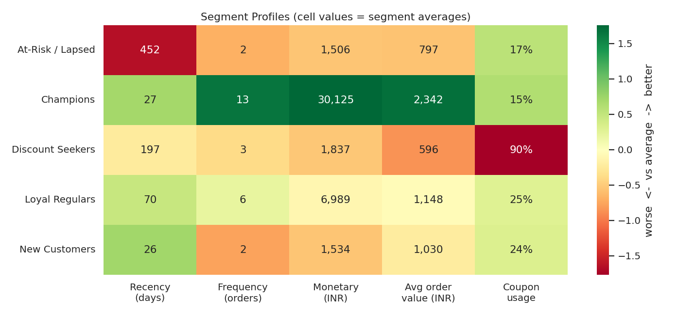
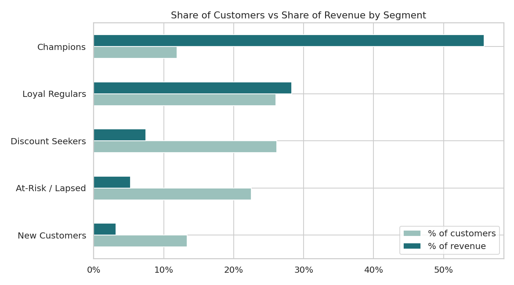

# Customer Segmentation: RFM Analysis + K-Means Clustering

Segmenting **5,000 customers and 24,000+ orders** of a D2C e-commerce brand by purchasing behaviour, using **SQL** for feature extraction and **K-Means** for clustering, then turning each segment into a concrete marketing action.



## Business problem
The marketing team was sending the same campaigns and discounts to every customer. The goal: find natural customer groups so retention, upsell and discount budgets can be targeted where they have the most impact.

## Tech stack
Python · SQL (SQLite, MySQL-compatible) · Pandas · NumPy · Scikit-learn · Matplotlib · Seaborn · Jupyter

## Approach
1. **Data model**: relational database with `customers` and `orders` tables (`sql/01_schema.sql`).
2. **Feature extraction in SQL**: CTEs and aggregations compute per-customer Recency, Frequency, Monetary value, average order value, coupon usage, return rate and tenure (`sql/02_customer_features.sql`).
3. **Preprocessing**: log transform on skewed features, then standard scaling.
4. **Choosing k**: elbow method plus silhouette score across k = 2–9. k = 5 gives the clearest jump in silhouette (0.385 → 0.43) and stays actionable.
5. **Clustering & profiling**: K-Means (k = 5, silhouette ≈ 0.43), clusters named by their behaviour, visualised with PCA.
6. **Recommendations**: a marketing play for each segment.

## Results

| Segment | % of customers | % of revenue | Avg recency (days) | Avg orders | Coupon usage |
|---|---|---|---|---|---|
| Champions | 11.7% | 55.8% | 27 | 12.9 | 15% |
| Loyal Regulars | 25.6% | 28.3% | 70 | 6.1 | 25% |
| Discount Seekers | 25.7% | 7.5% | 197 | 3.3 | 90% |
| At-Risk / Lapsed | 22.2% | 5.3% | 452 | 1.9 | 17% |
| New Customers | 13.1% | 3.2% | 26 | 1.5 | 24% |



## Key insights
- **12% of customers (Champions) generate 56% of revenue.** Protecting this group matters more than acquiring new low-value buyers.
- **Discount Seekers are a quarter of the base but only 7.5% of revenue,** and use coupons on 90% of orders. Flat discounts to this group erode margin.
- **22% of customers have lapsed** (no purchase in ~15 months on average), a clear win-back opportunity.
- **New customers need a second purchase fast:** they show high intent (recent, decent order value) but only 1.5 orders so far.

## Recommended actions
| Segment | Action |
|---|---|
| Champions | VIP early access, loyalty points, referral rewards; no blanket discounts |
| Loyal Regulars | Cross-sell gift sets, bundles and subscriptions to move them up |
| Discount Seekers | Minimum-order-value offers and bundles instead of flat coupons |
| New Customers | Onboarding email/WhatsApp flow with a 30-day second-purchase incentive |
| At-Risk / Lapsed | Time-limited win-back offer; suppress from paid retargeting if unresponsive |

## Project structure
```
customer-segmentation/
├── data/
│   ├── customers.csv
│   └── orders.csv
├── sql/
│   ├── 01_schema.sql               # table definitions
│   ├── 02_customer_features.sql    # RFM + behaviour features (CTEs)
│   └── 03_business_queries.sql     # exploration queries (window functions, joins)
├── src/
│   ├── generate_data.py            # builds synthetic data + SQLite database
│   └── segmentation.py             # scaling, K-Means, profiling, charts
├── notebooks/
│   └── customer_segmentation.ipynb # full walkthrough with outputs
├── reports/
│   ├── customer_segments.csv       # segment per customer
│   ├── segment_summary.csv
│   └── figures/
├── requirements.txt
└── README.md
```

## How to run
```bash
git clone https://github.com/abhi07082004/customer-segmentation.git
cd customer-segmentation
pip install -r requirements.txt

python src/generate_data.py   # creates data/*.csv and data/ecommerce.db
python src/segmentation.py    # runs clustering, saves reports and charts
```
Or open `notebooks/customer_segmentation.ipynb` for the step-by-step version.

## Dataset note
The data is **synthetic**, generated to reflect realistic D2C behaviour (repeat buyers, coupon-driven shoppers, lapsed and new customers, Tier 1/2/3 Indian cities). The hidden behaviour profiles used to generate it are not stored in the database; the clustering discovers the groups from purchase behaviour alone.

## Author
**Abhishek Pathak** · [LinkedIn](https://www.linkedin.com/in/abhishek-pathak-73851732a)
